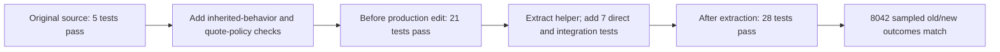

# Service-fee characterization

## Flow diagram



All stages above were executed. This diagram records the validation workflow, not an application call graph.

## Key findings

* **Verified fact:** 14 new characterization methods record current public behavior, including known invoice-rate drift, iterator exhaustion and unvalidated negative values.
* **Verified fact:** two separate policy methods verify established quote rules. They do not assert invoice compliance with the approved 10% policy.
* **Verified fact:** 21 tests passed before production edits; 28 pass afterward, including seven shared-helper/integration tests.
* **Open question:** the accepted input schema and unusual numeric-object behavior remain unspecified; sampled parity cannot prove universal equivalence.

## Detailed explanation

Purpose: protect observed behavior before extraction without endorsing defects. Inputs: existing fixtures, source arithmetic, approved policy and risk findings. Actions: add deterministic `unittest` cases, run before/after production changes, compare baseline revision with final source, then demonstrate a rounding regression in isolation. Outputs: the tests below and [recorded execution evidence](docs/service-fee-validation.json). Decision: preserve historical results; only quote-policy tests claim intended-rule compliance. Completion criteria: baseline recorded, characterization passes on original/final code, both integrations covered, defect labels explicit.

The test prefix below is `learner/starter/booking_platform/tests/`. Test names in the matrix are exact method names. Results use `(subtotal, fee, total)` shorthand; returned values remain dictionaries with the three public keys.

| Test | Path | Inputs | Current result | Intended result, if established | Evidence | Status |
|---|---|---|---|---|---|---|
| `test_typical_quote_and_historical_invoice_policy_conflict` | Both | Rate 100, nights 2, count absent | Quote `(200,20,220)`; invoice `(200,24,224)` | Both `(200,20,220)` under [policy:5-9](learner/starter/booking_platform/policy/business_rules.md#L5) | [characterization:13-17](learner/starter/booking_platform/tests/test_service_fee_characterization.py#L13) | Complete; pass before/after; historical invoice defect |
| `test_empty_input_preserves_exact_shape_and_integer_fee` | Both | `[]` | Exact dict `(0,0,0)`, int fee | Same; [policy:9](learner/starter/booking_platform/policy/business_rules.md#L9) | [characterization:19-24](learner/starter/booking_platform/tests/test_service_fee_characterization.py#L19) | Complete; pass before/after |
| `test_explicit_room_count_and_multiple_lines` | Both | `100*2*2 + 50*1*1` | Quote `(450,45,495)`; invoice `(450,54,504)` | Both `(450,45,495)` | [characterization:26-29](learner/starter/booking_platform/tests/test_service_fee_characterization.py#L26) | Complete; historical invoice rate retained |
| `test_quote_aggregates_before_rounding` | Quote | Two line bases 5 | `(10,1,11)` | Same; aggregate 10% policy | [characterization:31-33](learner/starter/booking_platform/tests/test_service_fee_characterization.py#L31) | Complete; pass before/after |
| `test_historical_invoice_rounds_aggregate_line_fees_once` | Invoice | Two line bases 4 | `(8,1,9)` | Same rounded numeric result at policy 10%; does not establish rate compliance | [characterization:35-38](learner/starter/booking_platform/tests/test_service_fee_characterization.py#L35) | Complete; rounding position preserved |
| `test_quote_ties_round_to_even` | Quote | Bases 5, 15, 25, 35 separately | Fees 0, 2, 2, 4 | Same Python rounding rule | [characterization:40-43](learner/starter/booking_platform/tests/test_service_fee_characterization.py#L40) | Complete; pass before/after |
| `test_historical_invoice_fractional_ties_round_to_even` | Invoice | Bases 12.5, 37.5 separately | `(12.5,2,14.5)`, `(37.5,4,41.5)` | Policy fees 1, 4 respectively; first exposes rate drift | [characterization:45-49](learner/starter/booking_platform/tests/test_service_fee_characterization.py#L45) | Complete; historical results, not policy approval |
| `test_zero_count_is_not_replaced_by_default` | Both | Rate 100, nights 2, count 0 | `(0,0,0)` | Zero-subtotal rule agrees; count validity unspecified | [characterization:51-56](learner/starter/booking_platform/tests/test_service_fee_characterization.py#L51) | Complete; pass before/after |
| `test_negative_values_are_currently_not_rejected` | Both | Rate -100, nights 1 | Quote `(-100,-10,-110)`; invoice `(-100,-12,-112)` | Unknown allowed-input policy | [characterization:58-61](learner/starter/booking_platform/tests/test_service_fee_characterization.py#L58) | Complete; limitation explicitly recorded |
| `test_one_shot_iterator_preserves_historical_invoice_exhaustion` | Both | Iterator over rate 100, nights 2 | Quote `(200,20,220)`; invoice `(200,0,200)` | Accepted iterator contract unspecified; normal policy formula would imply fee 20 | [characterization:63-67](learner/starter/booking_platform/tests/test_service_fee_characterization.py#L63) | Complete; reproduced historical limitation |
| `test_missing_required_fields_preserve_key_error` | Both | Missing rate or nights | `KeyError` with missing-key argument | Error schema unknown; preserve current | [characterization:69-75](learner/starter/booking_platform/tests/test_service_fee_characterization.py#L69) | Complete; pass before/after |
| `test_invalid_inputs_preserve_type_error` | Both | `None`, `[None]`, count `None` | `TypeError` | Error schema unknown | [characterization:77-82](learner/starter/booking_platform/tests/test_service_fee_characterization.py#L77) | Complete; pass before/after |
| `test_decimal_values_remain_incompatible_with_float_rates` | Both | Decimal rate 100, nights 1 | `TypeError` | Currency numeric type unspecified | [characterization:84-87](learner/starter/booking_platform/tests/test_service_fee_characterization.py#L84) | Complete; no silent numeric conversion |
| `test_non_finite_values_preserve_rounding_errors` | Both | NaN, positive infinity | `ValueError`, `OverflowError` | Validation/HTTP error policy unknown | [characterization:89-94](learner/starter/booking_platform/tests/test_service_fee_characterization.py#L89) | Complete; pass before/after |
| `test_quote_uses_ten_percent_of_total_then_rounds_once` | Quote policy | Two line bases 5 | `(10,1,11)` | Same; [policy:5-8](learner/starter/booking_platform/policy/business_rules.md#L5) | [policy test:100-102](learner/starter/booking_platform/tests/test_service_fee_characterization.py#L100) | Complete; intended-rule test |
| `test_quote_zero_subtotal_has_no_fee` | Quote policy | `[]` | `(0,0,0)` | Same; [policy:9](learner/starter/booking_platform/policy/business_rules.md#L9) | [policy test:104-105](learner/starter/booking_platform/tests/test_service_fee_characterization.py#L104) | Complete; intended-rule test |
| `test_aggregate_fee_is_rounded_once` | Shared | Bases `(5,5)`, rate .10 | Fee 1 | Same single-round rule | [shared test:15-16](learner/starter/booking_platform/tests/test_service_fee.py#L15) | Complete; also fails targeted regression |
| `test_rate_is_required_and_has_no_default` | Shared | Base 200, explicit .10/.12 | Fees 20/24 | Rate is caller-selected; invoice .12 is historical only | [shared test:18-20](learner/starter/booking_platform/tests/test_service_fee.py#L18); [helper signature:6](learner/starter/booking_platform/src/service_fee.py#L6) | Complete; two explicit-rate results tested; signature has no default |
| `test_empty_input_returns_integer_zero`, `test_ties_round_to_even`, `test_invalid_amount_propagates_type_error` | Shared | Empty bases; bases 5/15; `None` base | Int zero; fees 0/2; TypeError | Zero/rounding established; malformed-input intent unspecified | [shared tests:22-33](learner/starter/booking_platform/tests/test_service_fee.py#L22) | Complete; three methods pass |
| `test_quote_supplies_one_aggregate_base_at_ten_percent` | Quote adapter | Two line bases 5 | Shared call `((10,), .10)`; response `(10,1,11)` | Same approved quote formula | [shared test:35-39](learner/starter/booking_platform/tests/test_service_fee.py#L35) | Complete; integration verified |
| `test_invoice_supplies_line_bases_at_historical_twelve_percent` | Invoice adapter | Two line bases 4 | Shared inputs `[4,4]`, .12; response `(8,1,9)` | Historical adapter only; intended rate .10 | [shared test:41-53](learner/starter/booking_platform/tests/test_service_fee.py#L41) | Complete; integration verified |

Exact test command, run from `learner/starter/booking_platform`:

```powershell
python -B -m unittest discover -s tests -v
```

| Stage | Outcome | Revision/state |
|---|---|---|
| Original baseline | 5 tests, OK, exit 0 | Clean base `7f33d5187432716a85928e148e6b65483bc93434` |
| Added characterization/policy checks, before production edits | 21 tests, OK, exit 0 | Base production source plus new characterization file |
| Extraction plus direct/helper integration checks | 28 tests, OK, exit 0 | Final uncommitted source; hashes in evidence JSON |
| Differential comparison | 8,042 outcomes matched over 2,011 fixtures, each path and list/iterator variants where applicable | Original source loaded from base Git revision vs final source |

The reproducible validation command from repository root is `python -B docs/validate_service_fee.py`. It writes [evidence JSON](docs/service-fee-validation.json), including exact subprocess commands/output and final source SHA-256 hashes. Fixed random seed: `60429`. Compared return keys/order, value types and representations, plus exception class/arguments. NaN required comparing representations because NaN is unequal to itself; this was a harness correction, not an application defect.

## Existing limitations and scope boundaries

Discounts, taxes, caps and exemptions are absent from the inspected implementation, so no invented tests were added for them. No test asserts that historical invoice behavior meets policy. No invoice-policy acceptance test is claimed to pass. No new validation, Decimal support, iterator repair or cancellation change was made.

Black, isort and mypy are unavailable in this environment; those checks are **Not run**. No packages were installed. Tests use the existing `unittest` framework as requested. Mermaid rendering and runtime performance profiling were not run.

## Scope for improvement

Proposed: after a reviewed invoice behavior-change decision, add cross-path equality acceptance cases and intentionally update historical expectations. Input-schema decisions should precede new rejection rules. Custom numeric types need an explicit support decision before compatibility claims are expanded.

## Completion evidence

| Criterion | Status | Evidence |
|---|---|---|
| Original baseline before production changes | Complete | 5-test result recorded above and in [JSON](docs/service-fee-validation.json) |
| Executable characterization before/after | Complete | 14 inherited-behavior methods; 21 before / 28 final suite |
| Intended rule separated from inherited defects | Complete | `QuotePricingPolicyTests` vs `ServiceFeeCharacterizationTests` |
| Shared helper and both integrations tested | Complete | [Seven direct/integration methods](learner/starter/booking_platform/tests/test_service_fee.py#L12) |
| Deliberate regression fails, restoration passes | Complete | [Regression output](docs/service-fee-validation.json); [procedure](guarded_refactor.md) |
| Invoice compliance with intended 10% rule | Blocked | No reviewed behavior-change authorization; current 12% retained |
| Formatter/import-sorter/type checker | Not run | Tools unavailable; availability recorded in JSON |
