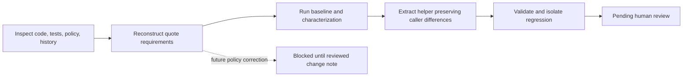

# Pricing requirements and extraction plan

## Flow diagram

Solid stages through validation are completed. Human review is pending. The dashed branch is proposed future behavior change, not implemented architecture.

## Key findings

* **Verified fact:** booking quote is the primary reconstructed module because its aggregate 10% formula agrees with approved pricing policy and the existing ordinary-case test. This gives a grounded intended-rule test without approving invoice's historical rate.
* **Verified fact:** preserving quote/invoice differences does not require deciding which policy to apply during extraction. Both now supply explicit bases and rates to one helper.
* **Open question:** a human must authorize any subsequent invoice correction, validator change or iterator-contract change; none is included here.

## Detailed explanation

Purpose: separate requirements from inherited implementation, then define a safe extraction. Inputs: [approved app policy:5-12](learner/starter/booking_platform/policy/business_rules.md#L5), [existing quote tests:5-10](learner/starter/booking_platform/tests/test_quote.py#L5), [current quote source:6-12](learner/starter/booking_platform/src/pricing.py#L6), invoice context, and Git history. Outputs: the requirement table, extraction decisions and validation evidence.

History inspection: `git log --oneline -- learner/starter/booking_platform` identifies only `41b8b1c` (`lab for day4`) for application changes. `git show 41b8b1c:learner/starter/booking_platform/src/pricing.py` and the invoice equivalent confirm the inherited 10%/12% formulas. The pre-change base is `7f33d5187432716a85928e148e6b65483bc93434`; history supplies no reviewed correction or additional requirements.

Confidence refers to the evidence for the stated rule, not approval to change behavior: **High** = clear, consistent relevant sources; **Medium** = credible but incomplete evidence or one authoritative source; **Low** = inference, ambiguity or conflict about intended behavior. Observed behavior may be verified even when confidence in its intent is Low.

| ID | Rule | Observed behavior | Intended behavior | Evidence | Confidence | Conflict or open question |
|---|---|---|---|---|---|---|
| R1 | Quote input shape | Required `rooms`; tested list of line dicts | Room lines with rate, nights and count are policy inputs; collection/schema details unspecified | [pricing:6-10](learner/starter/booking_platform/src/pricing.py#L6); [quote test:6](learner/starter/booking_platform/tests/test_quote.py#L6); [policy:6](learner/starter/booking_platform/policy/business_rules.md#L6) | Medium: schema incomplete | Are iterators, negative/fractional values supported business inputs? |
| R2 | Missing count | `room.get("rooms", 1)` defaults count to one | Not explicitly stated by policy | [pricing:7](learner/starter/booking_platform/src/pricing.py#L7); [quote test:6-7](learner/starter/booking_platform/tests/test_quote.py#L6) | Medium: code and fixture, no explicit policy | Preserve default; do not invent validation |
| R3 | Room subtotal | Sum `nightly_rate * nights * rooms` across lines | Same aggregate line formula | [pricing:6-7](learner/starter/booking_platform/src/pricing.py#L6); [policy:6](learner/starter/booking_platform/policy/business_rules.md#L6); [characterization:26-29](learner/starter/booking_platform/tests/test_service_fee_characterization.py#L26) | High: consistent sources | Currency not identified |
| R4 | Quote fee rate/base | 10% of aggregate subtotal | 10% after summing all room lines | [pricing:10-11](learner/starter/booking_platform/src/pricing.py#L10); [quote test:6-7](learner/starter/booking_platform/tests/test_quote.py#L6); [policy:5-6](learner/starter/booking_platform/policy/business_rules.md#L5) | High: consistent sources | No change authorized/needed |
| R5 | Fee rounding | Python `round` once on aggregate fee | Python `round` once, whole currency unit | [helper:22](learner/starter/booking_platform/src/service_fee.py#L22); [policy:8](learner/starter/booking_platform/policy/business_rules.md#L8); [policy test:100-102](learner/starter/booking_platform/tests/test_service_fee_characterization.py#L100) | High: policy, source, passing test | Arbitrary numeric types not established |
| R6 | Total and response | Dict with `subtotal`, `service_fee`, `total`; total = subtotal + fee | Same total equation; preserve response keys | [api:7](learner/starter/booking_platform/src/api.py#L7); [quote tests:7-10](learner/starter/booking_platform/tests/test_quote.py#L7); [policy:9](learner/starter/booking_platform/policy/business_rules.md#L9) | High: consistent evidence | No HTTP serialization contract present |
| R7 | Empty/zero subtotal | Zero subtotal, fee, total; fee integer | Zero subtotal means zero fee | [baseline:7-10](learner/starter/booking_platform/tests/test_baseline_contracts.py#L7); [policy:9](learner/starter/booking_platform/policy/business_rules.md#L9); [policy test:104-105](learner/starter/booking_platform/tests/test_service_fee_characterization.py#L104) | High | Negative offsets/net zero not separately specified |
| R8 | Errors and invalid values | Uncaught built-in errors; negatives accepted; Decimal/float mixing errors | No approved error schema or negative-value rule | [characterization:58-94](learner/starter/booking_platform/tests/test_service_fee_characterization.py#L58) | Low for intent: policy silent | Preserve tested errors; do not add validation |
| R9 | Quote/invoice equality | Typical subtotal 200 gives quote fee 20, invoice fee 24 | Same 10% pricing rule | [characterization:13-17](learner/starter/booking_platform/tests/test_service_fee_characterization.py#L13); [policy:5-7](learner/starter/booking_platform/policy/business_rules.md#L5) | Medium for intended migration: authoritative policy but compatibility conflict | Intended rule is clear; permission to change existing invoice behavior is pending reviewed design |
| R10 | Taxes, discounts, caps, exemptions | No implementation parameters or branches found | Unspecified; no rules reconstructed | [quote source:6-12](learner/starter/booking_platform/src/pricing.py#L6), [invoice:6-11](learner/starter/booking_platform/src/invoice.py#L6) | Low: absence does not establish business policy | Do not add these features |

Implementation sequence and decision gates:

1. **Inspect and baseline — Complete.** Read instructions, public callers, tests, policy and history. Run original suite: 5 passed. Gate: working tree initially clean, no extra runtime dependencies needed.
2. **Characterize — Complete.** Add 14 inherited-behavior methods and two separate quote-policy methods. Before production changes, 21 tests passed. Gate: current defects labeled explicitly, no failing behavior silently reclassified as intended.
3. **Extract — Complete.** Add `src/service_fee.py`; quote passes `(subtotal,)` at `0.10`; invoice passes line bases at `0.12` and retains two traversals. Existing public signatures stay unchanged. Gate: preserve formulas, operation order for ordinary numeric inputs, error propagation and return shapes.
4. **Validate — Complete.** Seven helper/integration methods added; 28 tests pass. Compare 8,042 sampled outcomes against base revision. Demonstrate aggregate-rounding test failure in a temporary copy, restore it and rerun. Gate: no defect left in final source, no out-of-scope application changes.
5. **Human review — Blocked pending review.** Reviewer validates reconstructed intent, compatibility evidence and residual custom-type uncertainty. No approval has been supplied.
6. **Policy correction — Blocked, separate change.** No reviewed note authorizes changing invoice to 10%, iterator handling or validation. These remain preserved rather than silently corrected.

## Existing limitations and scope boundaries

No new dependencies, configuration, CI, framework migration or repository-wide cleanup. The request's existing-framework requirement is followed with `unittest`; no switch to pytest. Existing public annotations are not changed because signatures must stay stable. Cancellation remains out of scope. Compatibility evidence covers tested and sampled inputs, not every possible Python object.

## Scope for improvement

Proposed follow-up: human-reviewed invoice migration with explicit acceptance examples, then an independently scoped input/currency/error contract. Broader infrastructure changes are not prerequisites for this extraction and were not added.

## Completion evidence

| Criterion | Status | Evidence |
|---|---|---|
| Select and reconstruct one module | Complete | Quote requirements R1-R10 above |
| Triangulate policy, tests, code and available history | Complete | Linked sources and exact history commands above |
| Classify confidence/conflicts | Complete | Requirement table and confidence definitions |
| Execute preservation/validation plan | Complete | [Characterization](Characterization.md); [machine-readable evidence](docs/service-fee-validation.json) |
| Authorize behavior corrections | Blocked | No reviewed design note supplied |
| Human acceptance | Blocked | [Pending reviewer record](guarded_refactor.md) |
