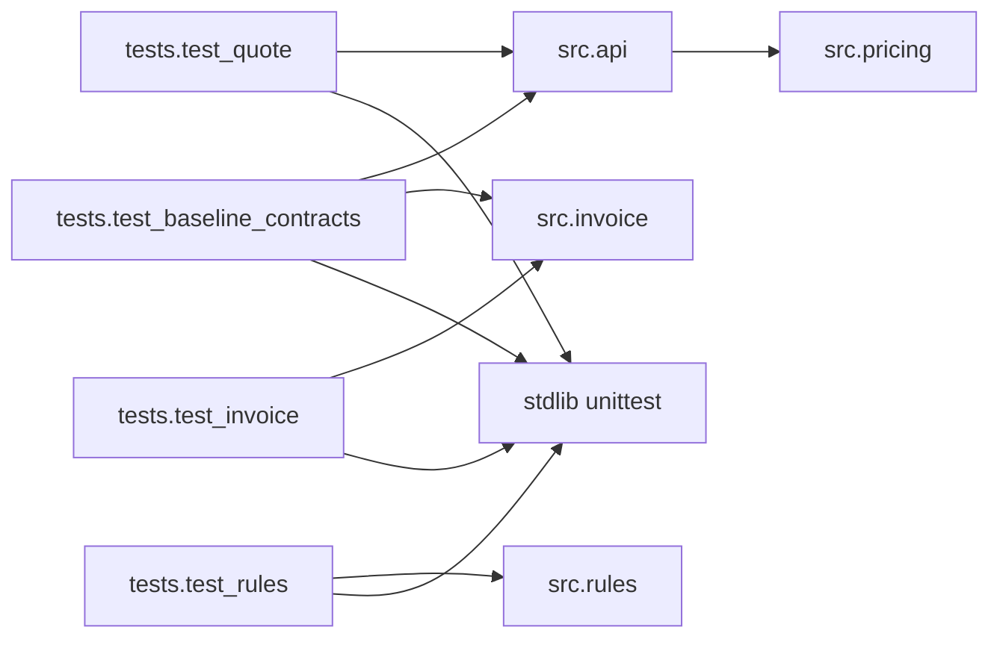

# Module dependency map

> Archived pre-refactor discovery snapshot at `d6581c9770db2cd48fc022bb41800d15d58cca2d`. Findings, test-execution status and source line references below describe that revision, not the current working tree. For the final shared-helper architecture and runtime evidence, see [current flow report](../../flow_diagram.md) and [guarded refactor](../../guarded_refactor.md).

[Overview](01-architecture-overview.md) · [Call graph](04-function-call-graph.md) · [Impact](07-change-impact-analysis.md)

Scope: all ten Python files under `learner/starter/booking_platform`. Source paths in the tables are relative to that application directory. Direct means an explicit import; transitive means reachable through such an import. Calls to built-ins are listed in the function inventory, not treated as third-party dependencies.

## Direct and transitive dependencies

| Module | Direct dependency / imported symbol | Transitive local dependency | Evidence |
|---|---|---|---|
| `src/api.py` | `src.pricing.calculate_quote` | None beyond pricing | [api:2](../../learner/starter/booking_platform/src/api.py#L2) |
| `src/pricing.py` | None | None | [entire module:1-15](../../learner/starter/booking_platform/src/pricing.py#L1) |
| `src/invoice.py` | None | None | [entire module:1-7](../../learner/starter/booking_platform/src/invoice.py#L1) |
| `src/rules.py` | None | None | [entire module:1-6](../../learner/starter/booking_platform/src/rules.py#L1) |
| `tests/test_quote.py` | `unittest`, `src.api.create_quote` | `src.pricing` | [test_quote:1-2](../../learner/starter/booking_platform/tests/test_quote.py#L1) |
| `tests/test_invoice.py` | `unittest`, `src.invoice.preview_invoice` | None | [test_invoice:1-2](../../learner/starter/booking_platform/tests/test_invoice.py#L1) |
| `tests/test_rules.py` | `unittest`, `src.rules.cancellation_fee_due` | None | [test_rules:1-2](../../learner/starter/booking_platform/tests/test_rules.py#L1) |
| `tests/test_baseline_contracts.py` | `unittest`, `src.api.create_quote`, `src.invoice.preview_invoice` | `src.pricing` | [baseline:1-3](../../learner/starter/booking_platform/tests/test_baseline_contracts.py#L1) |
| `src/__init__.py`, `tests/__init__.py` | None; empty initializers | None | Both files inspected; each contains only a blank line |

Every arrow is a direct import from the table. There is no import edge between invoice and pricing, or between the two cancellation implementations. Identical policy intent does not establish a code dependency.

## Library and version register

| Dependency | Kind | Version evidence | Direct/transitive status |
|---|---|---|---|
| Python runtime / built-ins (`sum`, `round`, `set`, `int`) | Runtime | No version declaration found | Direct use by source/tests; runtime implementation not vendored |
| `unittest` | Python standard library | Follows unknown runtime version | Direct in all four test modules |
| Third-party packages | None imported or declared in inspected checkout | No manifests or lockfiles found | No evidenced direct or transitive third-party graph |

No package can be classified as deprecated or unsupported from this repository alone. No external registry lookups or installations were performed. Absence of imports/manifests does not describe an undisclosed deployment environment.

## Coupling and cycles

* **No static import cycle:** the application import graph has one edge, `api -> pricing` ([api:2](../../learner/starter/booking_platform/src/api.py#L2)). The function graph is also acyclic.
* **Response-key coupling:** API accesses three exact pricing-result keys ([api:7](../../learner/starter/booking_platform/src/api.py#L7)); removing or renaming one creates a direct break.
* **Conceptual duplication:** quote/invoice duplicate line arithmetic and pricing policy while remaining import-independent ([pricing:4-9](../../learner/starter/booking_platform/src/pricing.py#L4), [invoice:4-7](../../learner/starter/booking_platform/src/invoice.py#L4)). The invoice expression rounds once after summing unrounded line fees; it does not round each line.
* **Cancellation duplication:** `pricing.cancellation_fee` and `rules.cancellation_fee_due` implement the same expressions separately ([pricing:11-15](../../learner/starter/booking_platform/src/pricing.py#L11), [rules:2-6](../../learner/starter/booking_platform/src/rules.py#L2)). No source caller connects them.
* **Execution-directory coupling:** absolute `src.*` imports depend on the application root being on Python's module search path. The documented test command is supplied in that application's README ([README:3-9](../../learner/starter/booking_platform/README.md#L3)); other launch contexts remain unverified.

## API-to-service-to-data relationship

The only verified layered path is Python caller -> `api.create_quote(rooms)` -> `pricing.calculate_quote(rooms)` -> `pricing.room_subtotal(rooms)` -> response dictionary. Data comes from caller-owned room mappings. No data-access layer or database relationship exists in the inspected implementation. Invoice and cancellation paths are direct function calls. See [execution diagrams](06-execution-flow.md).
