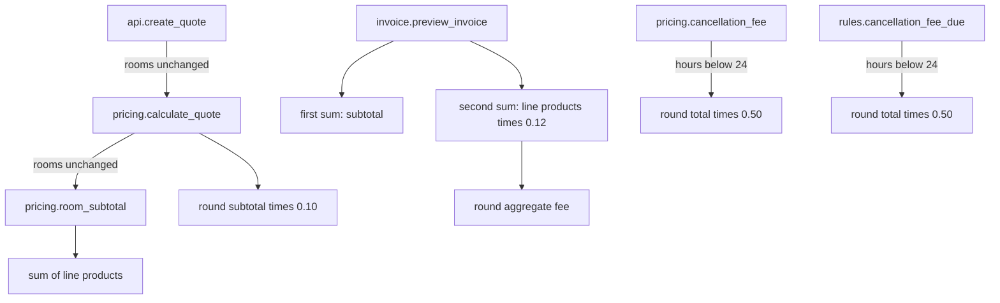
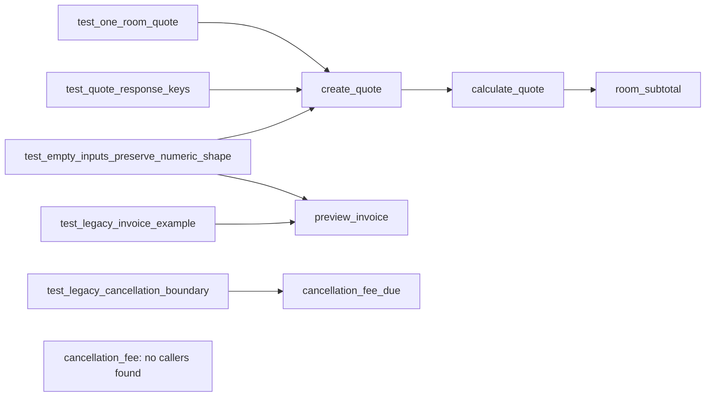

# Function-level call graph

[Module dependencies](02-module-dependency.md) · [Arguments/errors](03-function-inventory.md) · [Execution](06-execution-flow.md)

## Application edges

The diagrams include built-in arithmetic nodes for clarity; those nodes are expressions, not additional application functions. Invoice sums execute sequentially. Above-threshold cancellation returns literal `0` without calling `round`. No connection between invoice and pricing, or between the two cancellation helpers, is evidenced.

| Caller | Direct callee | Call-site evidence | Transitive application calls |
|---|---|---|---|
| `api.create_quote` | `pricing.calculate_quote` | [api.py:6](../../learner/starter/booking_platform/src/api.py#L6) | `pricing.room_subtotal` |
| `pricing.calculate_quote` | `pricing.room_subtotal` | [pricing.py:7](../../learner/starter/booking_platform/src/pricing.py#L7) | None |
| `pricing.room_subtotal` | No application callee; `sum`, line `.get` | [pricing.py:4](../../learner/starter/booking_platform/src/pricing.py#L4) | None |
| `invoice.preview_invoice` | No application callee; `sum`, `round`, line `.get` | [invoice.py:4-6](../../learner/starter/booking_platform/src/invoice.py#L4) | None |
| `pricing.cancellation_fee` | No application callee; conditional `round` | [pricing.py:13-15](../../learner/starter/booking_platform/src/pricing.py#L13) | None |
| `rules.cancellation_fee_due` | No application callee; conditional `round` | [rules.py:4-6](../../learner/starter/booking_platform/src/rules.py#L4) | None |

## All test-to-application call sites

| Caller test method | Direct call sites | Transitive application callees |
|---|---|---|
| `QuoteTests.test_one_room_quote` | `create_quote` — [test_quote.py:6](../../learner/starter/booking_platform/tests/test_quote.py#L6) | `calculate_quote`, `room_subtotal` |
| `QuoteTests.test_quote_response_keys` | `create_quote` — [test_quote.py:10](../../learner/starter/booking_platform/tests/test_quote.py#L10) | `calculate_quote`, `room_subtotal` |
| `InvoiceTests.test_legacy_invoice_example` | `preview_invoice` — [test_invoice.py:7](../../learner/starter/booking_platform/tests/test_invoice.py#L7) | None |
| `RuleTests.test_legacy_cancellation_boundary` | `cancellation_fee_due` twice — [test_rules.py:6-7](../../learner/starter/booking_platform/tests/test_rules.py#L6) | None |
| `BaselineContracts.test_empty_inputs_preserve_numeric_shape` | `create_quote`, `preview_invoice` — [baseline.py:7](../../learner/starter/booking_platform/tests/test_baseline_contracts.py#L7) | Through quote: `calculate_quote`, `room_subtotal` |

## Fan-in and fan-out

Counts are distinct direct caller functions, not execution frequency. Test assertion helpers and built-ins are excluded.

| Function | Direct application callers | Direct test callers | Direct application callees |
|---|---:|---:|---:|
| `create_quote` | 0 | 3 | 1 |
| `calculate_quote` | 1 | 0 | 1 |
| `room_subtotal` | 1 | 0 | 0 |
| `preview_invoice` | 0 | 2 | 0 |
| `cancellation_fee_due` | 0 | 1 | 0 |
| `cancellation_fee` | 0 | 0 | 0 |

No recursion, dynamically resolved application calls or cycles appear in source. Search scope was the entire checkout, with actual code edges confined to application source and tests. Mentions in walkthroughs are prose, not callers. External/runtime callers cannot be ruled out.
