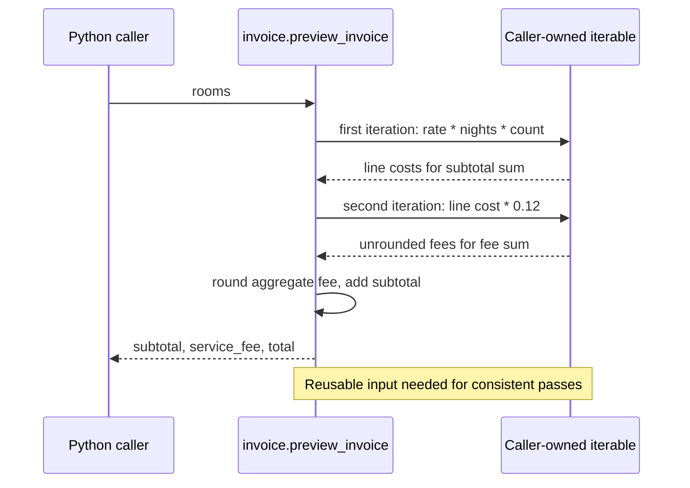
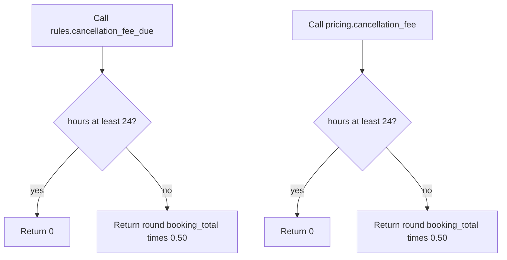
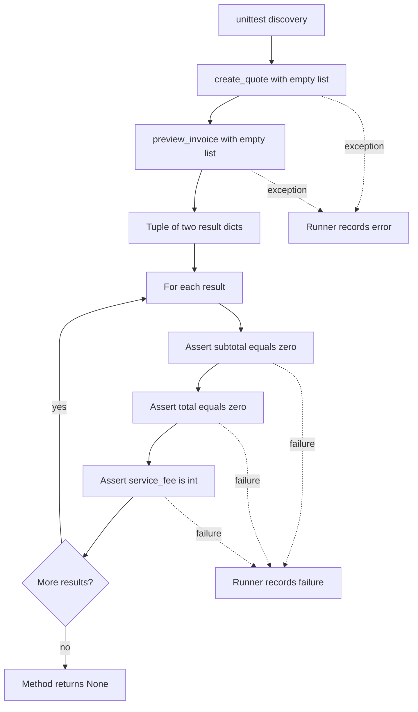
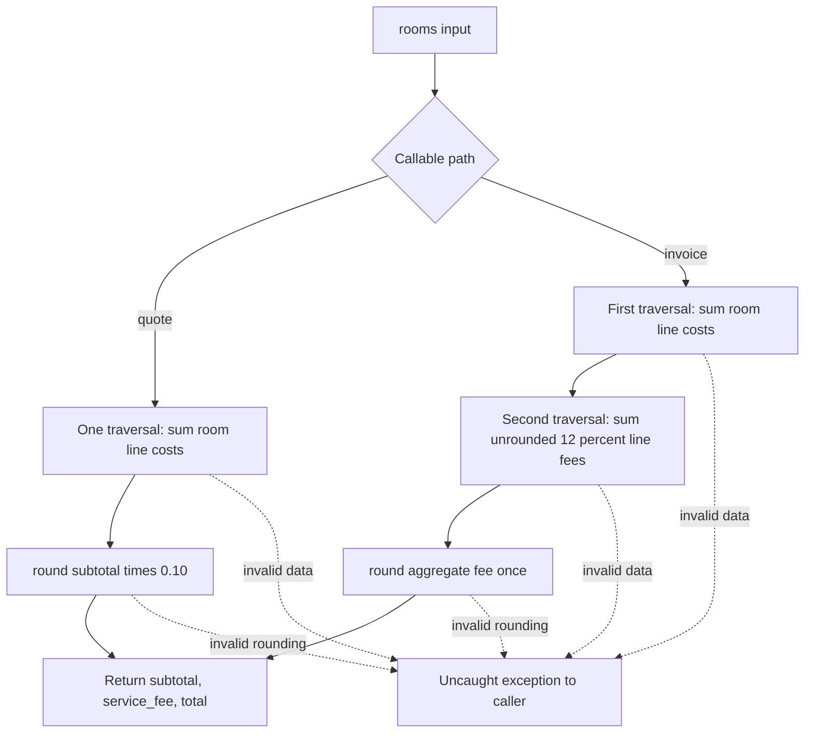

# Execution flows

[Contracts](05-api-and-data-contracts.md) · [Call graph](04-function-call-graph.md) · [Unknowns](08-unknowns-and-validations.md)

There are four distinct application entry paths. To provide five useful flows without inventing a background job, flow 5 describes the existing baseline test workflow. The user-facing nature of quote/invoice is documented intent; no HTTP dispatch or actual users are present in code. No background workflow was found.

## 1. Booking quote

Trigger: a Python consumer calls `create_quote(rooms)`; concrete callers are quote tests and baseline test. `rooms` is passed unchanged to `calculate_quote`, then to `room_subtotal`. The latter multiplies each line's rate, nights and optional count and sums the products. Pricing calculates `round(subtotal * 0.10)` and adds it to subtotal. The API copies exactly the three result fields into a new response dict. No persistence/network calls occur. Input/arithmetic errors propagate; absent pricing-result keys would fail in API assembly. [api:4-7](../../learner/starter/booking_platform/src/api.py#L4), [pricing:3-9](../../learner/starter/booking_platform/src/pricing.py#L3).

```mermaid
sequenceDiagram
    participant Caller as Python caller
    participant API as api.create_quote
    participant Pricing as pricing.calculate_quote
    participant Subtotal as pricing.room_subtotal
    Caller->>API: rooms
    API->>Pricing: rooms unchanged
    Pricing->>Subtotal: rooms unchanged
    Subtotal->>Subtotal: sum(rate * nights * count)
    Subtotal-->>Pricing: subtotal
    Pricing->>Pricing: fee = round(subtotal * 0.10)
    Pricing-->>API: subtotal, fee, total dict
    API-->>Caller: three-key response dict
    Note over Caller,Subtotal: No catch blocks; iteration/arithmetic failures propagate
```

## 2. Invoice preview

Trigger: direct `preview_invoice(rooms)` call from invoice or baseline tests. First traversal calculates subtotal. Second traversal recalculates each line's cost, multiplies each by `0.12`, sums these unrounded values and rounds the aggregate once. Return contains subtotal, fee and total. No API wrapper or shared pricing call occurs. An exhausted iterator can make the second sum zero; this is inferred, not reproduced. All errors propagate without rollback or error response. [invoice:3-7](../../learner/starter/booking_platform/src/invoice.py#L3).



## 3. Cancellation through rules helper

Trigger: `cancellation_fee_due(hours_before_checkin, booking_total)`. Only verified consumer is `RuleTests.test_legacy_cancellation_boundary`, passing `(24,200)` then `(23,200)`. Compare hours with `24`; return `0` on the free branch, otherwise return `round(booking_total * 0.50)`. No datetime conversion, booking cancellation, database update or external notification occurs. Comparison errors propagate; multiplication/rounding errors arise only on the charged branch. [rules:2-6](../../learner/starter/booking_platform/src/rules.py#L2), [test_rules:5-7](../../learner/starter/booking_platform/tests/test_rules.py#L5).

## 4. Cancellation through pricing helper

Trigger: an explicit call to `pricing.cancellation_fee(hours_before_checkin, booking_total)`; no caller is found in the checkout. Execution and output formula are identical to flow 3, but the implementation is separate and has no direct test. This is a dormant callable path in the inspected graph; real usage outside the repository is unknown. It does not call `rules.cancellation_fee_due`. [pricing:11-15](../../learner/starter/booking_platform/src/pricing.py#L11).



These are two separate paths, not a shared runtime component. Both conflict with the approved 48-hour window ([policy:10](../../learner/starter/booking_platform/policy/business_rules.md#L10)).

## 5. Baseline contract-check workflow

Trigger: `unittest` discovers `BaselineContracts.test_empty_inputs_preserve_numeric_shape` under the documented test command, which has not been run. Method line 7 evaluates `create_quote([])` first and `preview_invoice([])` second while constructing a tuple. It then loops through the two results, asserting subtotal zero, total zero and integer service fee. The method implicitly returns `None` if assertions pass; the runner reports results. A first-call exception prevents the second call; a second-call exception prevents assertions; assertion failure stops the remaining checks in this method. It does not assert fee equals zero explicitly. [baseline:5-10](../../learner/starter/booking_platform/tests/test_baseline_contracts.py#L5), [README:3-6](../../learner/starter/booking_platform/README.md#L3).



## Pricing transformation and failure overview



Diagrams are static reconstructions of cited source, not runtime traces. No database/API interaction nodes are included because none exist in the implementation.
