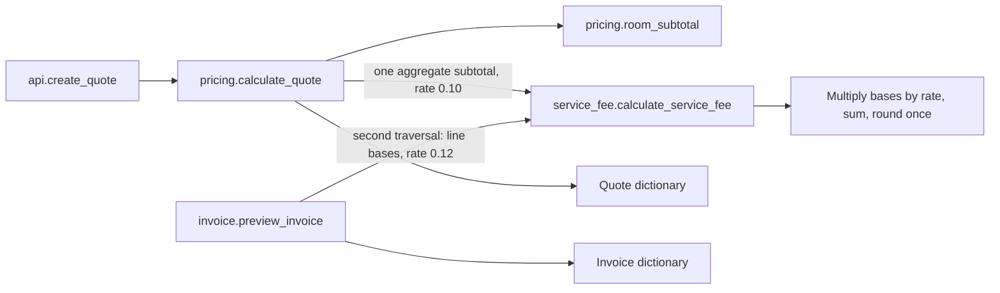

# Booking service-fee investigation

## Flow diagram

This is the **verified final working-tree graph**, not the pre-change graph. Quote calls subtotal before the fee helper. Invoice computes subtotal before its second traversal. The helper returns a fee to each caller; each caller computes the grand total. Evidence: [api.py:6-7](learner/starter/booking_platform/src/api.py#L6), [pricing.py:9-12](learner/starter/booking_platform/src/pricing.py#L9), [invoice.py:6-11](learner/starter/booking_platform/src/invoice.py#L6), [service_fee.py:6-22](learner/starter/booking_platform/src/service_fee.py#L6).

## Key findings

* **Verified fact:** quote and invoice now call the same service-fee function. Caller inputs preserve their previous formulas and rates.
* **Verified fact:** quote uses 10%; invoice still uses historical 12%. Approved policy requires 10% and equal pricing. The extraction intentionally does not resolve that conflict.
* **Verified fact:** both paths round once after aggregating fee amounts. Invoice did not previously round each line.
* **Verified fact:** the suite passes 28 tests, and 8,042 sampled original/final outcomes match. See [execution evidence](docs/service-fee-validation.json).
* **Open question:** currency, accepted numeric types and validation requirements remain unspecified beyond code and fixtures. Arbitrary custom numeric objects are not proven compatible.

## Detailed explanation

Purpose: understand both fee paths before changing them. Inputs: source, existing tests, approved policy and available Git history. Actions: inspect definitions/imports/callers, trace arithmetic, compare sources of intent, then validate a minimal extraction. Output: the graph above, parameter register and drift table below. Decision: preserve existing behavior; move only the common fee arithmetic. Completion criterion: every call edge is backed by a call site and corresponding tests.

| Path | Public interface and callers | Transformation and output | Test evidence |
|---|---|---|---|
| Quote | `create_quote(rooms)`; quote and baseline tests | `room_subtotal` sums `nightly_rate * nights * rooms`; fee helper receives `(subtotal,)` and `0.10`; response contains `subtotal`, `service_fee`, `total` | [existing quote tests:5-10](learner/starter/booking_platform/tests/test_quote.py#L5); [characterization:13-33](learner/starter/booking_platform/tests/test_service_fee_characterization.py#L13) |
| Invoice | `preview_invoice(rooms)`; invoice and baseline tests | First traversal sums line costs; second supplies line costs to helper at `0.12`; caller adds fee to subtotal and returns same three keys | [existing invoice test:5-8](learner/starter/booking_platform/tests/test_invoice.py#L5); [characterization:26-67](learner/starter/booking_platform/tests/test_service_fee_characterization.py#L26) |

Both interfaces have one required argument and no defaults/annotations; their signatures remain unchanged. There is no HTTP registration, database, tax/discount subsystem, background job or external API in inspected source. The `api.py` header explicitly says the network layer is omitted.

| Parameter | Actual name/source | Type / units | Default and validation | Influence |
|---|---|---|---|---|
| Room collection | `rooms`, both public functions | Iterable of room mappings; lists evidenced | Required; no validation | Quote consumes once; invoice traverses twice |
| Nightly price | `room["nightly_rate"]`, [pricing:7](learner/starter/booking_platform/src/pricing.py#L7), [invoice:7,9](learner/starter/booking_platform/src/invoice.py#L7) | Integer/float evidenced; currency unspecified, per night | Required; absent key raises `KeyError` | Multiplied by nights and count |
| Stay duration | `room["nights"]`, same expressions | Numeric multiplier; nights by naming, integer examples | Required; positivity/integrality not checked | Multiplies line cost |
| Room count | `room.get("rooms", 1)`, same expressions | Numeric multiplier; room count by naming | Missing -> `1`; explicit zero preserved; `None` errors | Multiplies line cost |
| Fee bases | `amounts`, [helper:6](learner/starter/booking_platform/src/service_fee.py#L6) | Iterable of monetary bases; same unspecified currency | Required; no normalization | One subtotal for quote, individual line bases for invoice |
| Fee rate | `rate`; caller literals at [pricing:11](learner/starter/booking_platform/src/pricing.py#L11), [invoice:9](learner/starter/booking_platform/src/invoice.py#L9) | Float fraction; `0.10` / `0.12` | Required helper input; no default or bounds check | Multiplies each supplied base |
| Precision / rounding | Python `round`, [helper:22](learner/starter/booking_platform/src/service_fee.py#L22) | Whole currency units, ties to even | One round after summation; runtime float arithmetic retained | Produces integer fee for tested int/float data |
| Discounts / taxes / ordering | No such fields or operations | Inapplicable to inspected implementation | No defaults/validation present | No evidenced effect; upstream adjustments unknown |
| Minimum / maximum / exemption | No such parameters or branches | Inapplicable to inspected implementation | Zero fee results from zero arithmetic, not an exemption switch | No evidenced caps or exemptions |
| Currency identity / conversion | No currency field or conversion | Unknown | Not configured | Caller must supply consistent units; this is not enforced |

| Finding | Classification | Evidence | Impact | Follow-up |
|---|---|---|---|---|
| Invoice 12% conflicts with policy's 10% | Verified fact | [invoice:9](learner/starter/booking_platform/src/invoice.py#L9); [policy:5-8](learner/starter/booking_platform/policy/business_rules.md#L5) | Invoice totals differ from intended pricing | Human-reviewed behavior-change note before correction |
| Historical invoice assertion preserves drift | Verified fact | [test_invoice:6-8](learner/starter/booking_platform/tests/test_invoice.py#L6) | Passing tests alone do not establish policy compliance | Keep characterization separate from policy acceptance |
| Invoice exhausts one-shot iterators before fee pass | Verified fact, reproduced | [characterization:63-67](learner/starter/booking_platform/tests/test_service_fee_characterization.py#L63) | Iterator input produces positive subtotal with zero fee | Preserve now; clarify accepted input before fixing |
| Negative inputs produce negative charges | Verified fact, reproduced | [characterization:58-61](learner/starter/booking_platform/tests/test_service_fee_characterization.py#L58) | Invalid business amounts may be accepted | Agree validation contract in separate scope |
| Divergent multiplication/aggregation may affect floating rounding | Hypothesis for untested values | Quote one base vs invoice line bases; 8,042 sampled outcomes preserve each original path | Replacing invoice with subtotal-based multiplication may change edge results | Do not reorder invoice arithmetic in this extraction |
| Cancellation 24h vs approved 48h | Verified fact, adjacent only | [pricing:16](learner/starter/booking_platform/src/pricing.py#L16), [rules:4](learner/starter/booking_platform/src/rules.py#L4), [policy:10](learner/starter/booking_platform/policy/business_rules.md#L10) | Unrelated policy defect | Record only; no cancellation changes |

## Existing limitations and scope boundaries

Only shared service-fee arithmetic is extracted. Public names, argument lists, response keys, tested exceptions, historical rates and input traversal remain stable. New helper types document ordinary numerical intent; they do not validate it. Sampled compatibility does not prove behavior for every user-defined numeric/mapping/iterable implementation or preserve traceback frames.

Pre-change discovery reports under `docs/repository-analysis/` are archived snapshots; they do not describe the final call graph. Current graph and source locations are in these four new documents.

## Scope for improvement

Proposed, not implemented: review invoice policy migration, define accepted input/currency rules, decide whether reusable inputs should be mandatory, and approve invalid-input behavior. No rate, cancellation, dependency, network, database, payment or UI change is bundled into extraction.

## Completion evidence

| Criterion | Status | Evidence |
|---|---|---|
| Entry points, callers, transformations and test map | Complete | Diagram/table above; [function-level integration checks:35-53](learner/starter/booking_platform/tests/test_service_fee.py#L35) |
| Duplication and policy drift distinguished | Complete | Drift table; [approved policy](learner/starter/booking_platform/policy/business_rules.md#L5) |
| Runtime validation of inspected fee paths | Complete | [28 passing tests and differential evidence](docs/service-fee-validation.json) |
| Resolve invoice policy conflict | Blocked | Reviewed behavior-change note not supplied; extraction preserves 12% |
| Mermaid rendered layout verification | Not run | Diagrams checked as source; no Mermaid renderer used |

Next: [requirements and plan](Refactoring_plan.md), [characterization](Characterization.md), [guarded extraction/reviewer record](guarded_refactor.md).
