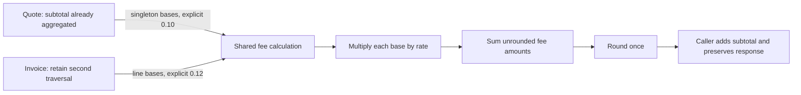

# Guarded service-fee extraction

## Flow diagram

This diagram is the implemented design. Human policy correction is a separate future decision, not a hidden stage in this path.

## Key findings

* **Verified fact:** both callers use `src.service_fee.calculate_service_fee(amounts, rate)`. Rates are required inputs; the helper selects no default business policy.
* **Verified fact:** quote retains aggregate 10%; invoice retains historical line-base 12%, second traversal and aggregate rounding. No known defect is silently corrected.
* **Verified fact:** 28 tests pass; 8,042 sampled original/final outcomes match; an isolated rounding regression fails and passes after restoration.
* **Open question:** human approval and authorization of any subsequent invoice policy correction remain pending. Reviewer-owned fields below have not been filled on anyone's behalf.

## Detailed explanation

Purpose: consolidate the genuinely common fee operation while preserving inherited caller differences. Inputs: the reviewed-by-code-inspection findings in [flow_diagram.md](flow_diagram.md), requirements in [Refactoring_plan.md](Refactoring_plan.md), and passing pre-change characterization. Actions: introduce one function, adapt only two call sites, test both paths, run isolated mutation, review scope. Outputs: helper, two new test modules, four requested documents and reproducible evidence tooling. Decision: extraction only, with no policy correction. Completion criteria: shared call path, before/after parity, direct tests, intended quote rule, detected/restored regression, review-ready record.

| Design item | Implemented contract / evidence |
|---|---|
| Function/location | `calculate_service_fee(amounts: Iterable[float], rate: float) -> int` in [src/service_fee.py:6-22](learner/starter/booking_platform/src/service_fee.py#L6) |
| Monetary inputs | Iterable of unrounded monetary bases in one caller-defined currency; integer/float data exercised; helper consumes iterable once |
| Rate | Explicit fractional multiplier; caller retains `0.10` or `0.12`; no default, cap, exemption, currency conversion or policy lookup |
| Output/precision | `round(sum(amount * rate for amount in amounts))`; whole-unit integer fee on tested int/float inputs; native Python float arithmetic and ties-to-even rounding |
| Errors | No catches or conversion; multiplication/iteration/summation/rounding errors propagate; tested classes/args match pre-change samples |
| Caller responsibility | Parse/access room fields, apply missing count default, calculate subtotal, choose fee bases/rate, add fee to subtotal, preserve public response |
| Side effects | No helper I/O, input mutation, network or persistence; consumes supplied iterator |

| Path | Pre-change expression | Final mapping | Preserved distinction |
|---|---|---|---|
| Quote | `round(subtotal * 0.10)` | `calculate_service_fee((subtotal,), 0.10)` at [pricing:11](learner/starter/booking_platform/src/pricing.py#L11) | Subtotal aggregates before fee multiplication; one fee base |
| Invoice | `round(sum(line_cost * 0.12 for room in rooms))` | Helper receives generator of `line_cost` values and `0.12` at [invoice:8-10](learner/starter/booking_platform/src/invoice.py#L8) | Multiply each line cost before summing fees; retains second traversal of input |

The rate discrepancy is a confirmed defect relative to [approved policy:5-7](learner/starter/booking_platform/policy/business_rules.md#L5), not an endorsed legitimate business difference. Explicit inputs preserve it temporarily under the user's instruction to avoid silent corrections. A common rate or a move to aggregate invoice multiplication would be a separate behavior change. The shared algorithm has no use-case flag or caller-name branch.

Public signatures remain unannotated and unchanged; adding annotations to these existing public signatures was intentionally avoided. The new helper has type hints and a Google-style docstring. No config, dependency, CI or framework changes are included.

Validation commands and outcomes:

| Command / working directory | Result |
|---|---|
| `python --version` / repository root | Python 3.14.4 |
| `python -B -m unittest discover -s tests -v` / application root, original source | 5 tests passed, exit 0 |
| Same command / application root, after characterization only | 21 tests passed, exit 0 |
| Same command / application root, after extraction | 28 tests passed, exit 0 |
| `python -B docs/validate_service_fee.py` / repository root | 8,042 parity outcomes matched; mutation failed as expected, restored test and full suite passed |
| `python -B -m unittest tests.test_service_fee.ServiceFeeTests.test_aggregate_fee_is_rounded_once -v` / isolated temporary copy | Mutated: one failure, `AssertionError: 0 != 1`, exit 1; restored: one pass, exit 0 |
| `git diff --check` / repository root | No tracked whitespace errors |
| `git diff -- learner/starter/booking_platform/src` / repository root | Reviewed: imports and two fee call sites only; no cancellation edit |

Final static checks also passed: all four required six-section orders, 108 local document links/line anchors, paired code fences, unchanged public function argument/return annotations, unchanged subtotal/cancellation syntax trees, new Python syntax and 120-character line limits, and recorded source/test SHA-256 hashes. These checks do not replace the unavailable formatter/type-checker runs or Mermaid rendering.

Temporary regression procedure: [validation harness `_regression`](docs/validate_service_fee.py) copies `src` and `tests` beneath a verified system-temporary path. Only the copy's helper is changed from `round(sum(amount * rate ...))` to `sum(round(amount * rate) ...)`. The targeted test uses two bases of 5 at 10%: correct aggregate result is 1; the mutation returns 0. The harness restores the copied helper before the passing rerun, then removes its own temporary tree. Real workspace source is never mutated. [Exact output, command argv, base revision and final hashes](docs/service-fee-validation.json) are retained.

Validation limitations encountered: an initial differential harness compared NaN by ordinary equality and was corrected to compare value types/representations; no application change followed. The first temporary-copy attempt was denied by workspace permissions. The successful harness rerun used approved escalation for temporary-copy creation and cleanup. No dependency installation or external-service access was needed.

Revision identity: base `7f33d5187432716a85928e148e6b65483bc93434`; extraction is an **uncommitted working-tree change**. Exact application/test file SHA-256 values are in the evidence JSON. No new commit or reviewer approval is claimed.

Changed/new artifacts:

| Files | Change / purpose |
|---|---|
| `learner/starter/booking_platform/src/pricing.py`, `src/invoice.py` | Import and call shared helper; retain caller formulas, rates, response construction and traversal |
| `learner/starter/booking_platform/src/service_fee.py` | New typed shared calculation |
| `learner/starter/booking_platform/tests/test_service_fee_characterization.py` | 14 characterization + two quote-policy methods |
| `learner/starter/booking_platform/tests/test_service_fee.py` | Seven helper/integration methods |
| `flow_diagram.md`, `Refactoring_plan.md`, `Characterization.md`, `guarded_refactor.md` | Four requested stage reports, each with required six-section order |
| `docs/validate_service_fee.py`, `docs/service-fee-validation.json` | Reproducible validation harness and captured evidence |
| `docs/repository-analysis/01-...08-*.md` | Archive notices only; prior discovery content retained as pre-refactor snapshot |

Rollback approach, proposed only: restore the two modified application files from the recorded base after checking for subsequent user edits; remove the new helper only after both callers are restored. Retain reports/test evidence for review. No reset, commit, push or rollback was performed.

## Existing limitations and scope boundaries

Invoice remains noncompliant with the approved rate; iterator exhaustion, negative acceptance, Decimal incompatibility and existing errors are characterized rather than repaired. Quote's single fee amount is now passed through `sum`; ordinary int/float outcomes match the sampled baseline, but exotic user-defined arithmetic such as custom addition methods is not proven equivalent. Traceback frames naturally include the new helper. No unsupported universal compatibility claim is made.

Cancellation, room-subtotal duplication, storage, transport, payment, UI, dependencies and unrelated cleanup remain outside the extraction. Existing response keys and public argument lists stay unchanged. Black, isort and mypy were unavailable and were not installed; those checks were not run. Older discovery reports are explicitly archived to avoid treating their pre-refactor call graph/test status as final.

## Scope for improvement

Proposed future gates: human reviews the extraction and residual compatibility uncertainty; a reviewed behavior-change note authorizes invoice migration to 10%; subsequent acceptance tests establish quote/invoice parity. Separately agree input schema, currency and validation before repairing historical input quirks. No such changes are included or automatically approved by passing characterization.

## Completion evidence

| Criterion | Status | Supporting artifact |
|---|---|---|
| Verified architecture, duplication and drift | Complete | [Flow report](flow_diagram.md) |
| Requirements reconstructed with evidence/confidence | Complete | [Requirement table](Refactoring_plan.md) |
| Characterization before/after extraction | Complete | [Test matrix](Characterization.md); [execution evidence](docs/service-fee-validation.json) |
| Both paths use one helper | Complete | Source call sites and [integration tests:35-53](learner/starter/booking_platform/tests/test_service_fee.py#L35) |
| Direct helper tests and intended quote policy | Complete | [Shared tests](learner/starter/booking_platform/tests/test_service_fee.py); [policy tests:97-105](learner/starter/booking_platform/tests/test_service_fee_characterization.py#L97) |
| Targeted regression fails, restored test passes | Complete | [Mutation evidence](docs/service-fee-validation.json) |
| Final application diff stays within fee extraction | Complete | Two adapted callers, one new helper; no dependency/config/integration changes |
| Formatter, import sorting and static type checks | Not run | Tools unavailable; no packages installed |
| Invoice policy correction / full parity acceptance | Blocked | Await reviewed behavior-change note; historical behavior preserved |
| Human review record available | Complete | Record below, ready for reviewer |
| Human acceptance | Blocked | Pending human review |

| Revision reviewed | Evidence reviewed | Residual risks | Decision | Reviewer | Date |
|---|---|---|---|---|---|
| Pending human review | Pending human review | Pending human review | Pending human review | Pending human review | Pending human review |

Suggested review package: base revision plus working-tree hashes, final diff, these four documents, tests, evidence JSON and the recorded invoice/custom-type limitations. This suggestion does not fill or approve the reviewer-owned record.
