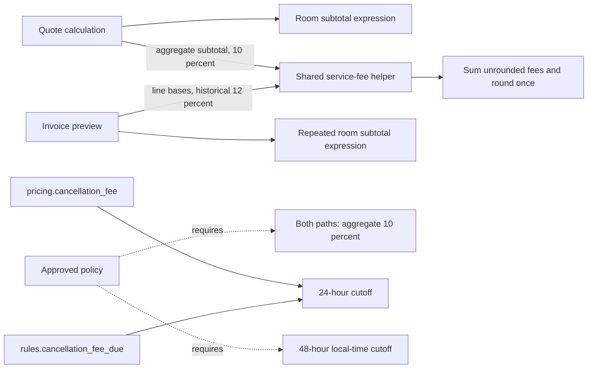

# Identify duplication and drift

## Flow diagram

Solid arrows describe verified calculations or dependencies. Dashed arrows describe approved requirements, not implemented calls. The two cancellation functions separately implement the same cutoff; neither calls the other. Source: [pricing.py:6-18](learner/starter/booking_platform/src/pricing.py#L6), [invoice.py:6-11](learner/starter/booking_platform/src/invoice.py#L6), [service_fee.py:22](learner/starter/booking_platform/src/service_fee.py#L22), [rules.py:2-6](learner/starter/booking_platform/src/rules.py#L2), [policy:5-10](learner/starter/booking_platform/policy/business_rules.md#L5).

## Key findings

* **Verified fact:** duplicated fee multiplication, aggregation and rounding have been extracted into one shared helper. Both quote and invoice call it.
* **Verified fact:** room-line arithmetic remains repeated across quote subtotal, invoice subtotal and invoice fee-base generation.
* **Verified fact:** invoice retains 12%, while quote and approved policy use 10%. Sharing code has not removed this policy drift.
* **Verified fact:** two cancellation helpers duplicate a 24-hour rule that conflicts with the approved 48-hour window. This is outside the service-fee refactor scope.
* **Verified fact:** existing invoice and cancellation tests preserve historical results. Passing those tests does not establish compliance with approved policy.

## Detailed explanation

Purpose: identify repeated responsibilities and disagreements among implementation, tests and approved business rules. Inputs: current source, tests, policy and the existing extraction evidence. Actions: compare formulas, call sites, defaults, traversal and assertions; distinguish observed behavior from intended rules. Output: the duplication and drift registers below. Decision: document remaining differences without changing behavior. Completion criterion: each finding has a source citation, impact and follow-up.

In plain language, **duplication** means the same calculation appears in several places. Changing one copy can leave another behind. **Drift** means a calculation or test no longer agrees with an approved rule. A shared function can reduce duplication while still producing different answers when its callers supply different rates.

| Item | Repeated or shared responsibility | Current status | Evidence | Maintenance consequence |
|---|---|---|---|---|
| Fee arithmetic | Multiply monetary bases by rate, sum fees, round once | Shared after extraction | [helper:6-22](learner/starter/booking_platform/src/service_fee.py#L6); [quote call:11](learner/starter/booking_platform/src/pricing.py#L11); [invoice call:8-10](learner/starter/booking_platform/src/invoice.py#L8) | Future changes to this algorithm reach both callers |
| Room-line formula | `nightly_rate * nights * room.get("rooms", 1)` | Still repeated in quote subtotal, invoice subtotal and invoice fee bases | [pricing:7](learner/starter/booking_platform/src/pricing.py#L7); [invoice:7-9](learner/starter/booking_platform/src/invoice.py#L7) | A count/default change could diverge across paths |
| Result construction | Return `subtotal`, `service_fee`, `total`; total equals subtotal plus fee | Similar result assembly remains local; API also copies these keys | [pricing:12](learner/starter/booking_platform/src/pricing.py#L12); [invoice:11](learner/starter/booking_platform/src/invoice.py#L11); [api:7](learner/starter/booking_platform/src/api.py#L7) | Shared output expectations need compatibility tests; duplication alone does not justify another abstraction |
| Cancellation calculation | Free from 24 hours; otherwise round 50% of booking total | Two separate implementations remain | [pricing:14-18](learner/starter/booking_platform/src/pricing.py#L14); [rules:2-6](learner/starter/booking_platform/src/rules.py#L2) | Updating one helper can leave the other stale; no extraction authorized here |

Let each room-line amount be `nightly_rate * nights * room_count`, with missing count defaulting to one. Quote first sums these amounts, then supplies one subtotal to the helper at 10%. Invoice first computes subtotal, then traverses the input again and supplies individual line amounts at 12%. Both round the aggregate fee once. Invoice does **not** round each room line separately.

For a nightly rate of 100 and two nights, quote returns subtotal 200, fee 20 and total 220; invoice returns subtotal 200, fee 24 and total 224. These exact historical results are asserted in [characterization:13-17](learner/starter/booking_platform/tests/test_service_fee_characterization.py#L13). Approved policy requires the quote's 10% formula for both paths, but the extraction deliberately preserves the invoice result until a reviewed behavior-change note authorizes correction.

| Finding | Classification | Evidence | Impact | Follow-up |
|---|---|---|---|---|
| Invoice uses 12%; policy requires 10% and equal quote/invoice pricing | Verified fact: policy drift | [invoice:9](learner/starter/booking_platform/src/invoice.py#L9); [policy:5-7](learner/starter/booking_platform/policy/business_rules.md#L5) | Different fees for the same ordinary booking | Obtain reviewed behavior-change authorization; intentionally update acceptance expectations |
| Invoice test expects fee 24 on subtotal 200 | Verified fact: historical test drift | [test_invoice:6-8](learner/starter/booking_platform/tests/test_invoice.py#L6) | A policy correction will deliberately change this expectation | Keep historical characterization distinct from policy acceptance |
| Both cancellation helpers use 24 hours; policy requires 48 hours | Verified fact: adjacent policy drift | [pricing:16](learner/starter/booking_platform/src/pricing.py#L16); [rules:4](learner/starter/booking_platform/src/rules.py#L4); [policy:10](learner/starter/booking_platform/policy/business_rules.md#L10) | The free-cancellation window disagrees with policy | Record for a separately scoped change; confirm local-time handling |
| Cancellation test preserves free cancellation at 24 hours | Verified fact: historical test drift | [test_rules:5-7](learner/starter/booking_platform/tests/test_rules.py#L5) | Test agreement with old code can obscure the approved rule | Review against policy before treating it as acceptance evidence |
| Invoice traverses input twice; quote consumes it once | Verified fact: behavioral difference, not itself an approved policy decision | [invoice:7-9](learner/starter/booking_platform/src/invoice.py#L7); [iterator characterization:63-67](learner/starter/booking_platform/tests/test_service_fee_characterization.py#L63) | One-shot iterator gives invoice subtotal 200 but fee zero in the tested case | Clarify supported input collection before repairing the limitation |
| Moving invoice multiplication after aggregate subtotal might change floating-point edges | Hypothesis for untested inputs | Different arithmetic ordering in [pricing:10-11](learner/starter/booking_platform/src/pricing.py#L10) and [invoice:7-9](learner/starter/booking_platform/src/invoice.py#L7) | Similar algebra does not guarantee identical floating-point results | Preserve order during extraction; test any future reordering |
| Supported currency, negative-value policy and numeric classes are unspecified | Open question | No validation in fee/room expressions; [negative and Decimal cases:58-87](learner/starter/booking_platform/tests/test_service_fee_characterization.py#L58) | New validation or conversion may change current errors/results | Agree explicit contracts before changing them |

Relevant parameters are caller-selected rate (fraction), room rate (unspecified currency per night), nights, optional count (default one), and whole-unit Python rounding. No tax, discount, cap or exemption implementation is present in these paths. The full parameter register is in [flow_diagram.md](flow_diagram.md).

## Existing limitations and scope boundaries

This document describes the current working tree after the fee extraction. Earlier discovery reports are marked as historical snapshots. Identified duplication is evidence for review, not an instruction to merge every similar-looking expression.

Only this Markdown file is created by this task. No application, tests, configuration, dependencies or existing documents are changed. Cancellation, input validation, monetary representation and invoice policy correction remain outside this documentation task.

Existing execution evidence records 28 passing tests and 8,042 sampled original/final outcomes matching. Those are prior validation results, not tests rerun for this document. They establish sampled preservation, not universal equivalence or invoice policy compliance. See [evidence JSON](docs/service-fee-validation.json) and [characterization report](Characterization.md).

## Scope for improvement

Proposed follow-ups, not implemented:

1. Human review of the preserved invoice policy conflict and a specific authorization to migrate it to 10%.
2. Quote/invoice equality tests accompanying that approved behavior change, while retaining clear records of historical results.
3. A decision on supported input collections, monetary types and invalid-input behavior before changing traversal or validation.
4. Separate review of cancellation policy drift; do not bundle it with service-fee maintenance.
5. Reconsider remaining room-line duplication only when a concrete requirement establishes that the implementations should evolve together.

## Completion evidence

| Criterion | Status | Evidence |
|---|---|---|
| Inspect current quote, invoice, helper, cancellation and approved policy | Complete | Source citations above |
| Distinguish resolved duplication from remaining duplication | Complete | Duplication register and current call diagram |
| Identify implementation/test/policy drift | Complete | Classified drift/risk table |
| Use the same six-section schema | Complete | Flow diagram, key findings, detailed explanation, limitations, improvements and evidence |
| Rerun application tests for this documentation-only task | Not run | Prior results linked; no application behavior changed |
| Render Mermaid diagram | Not run | Diagram provided as source |
| Resolve business-policy conflicts | Blocked | Separate reviewed behavior-change authorization required |
| Human approval | Blocked | [Reviewer record remains pending](guarded_refactor.md) |
